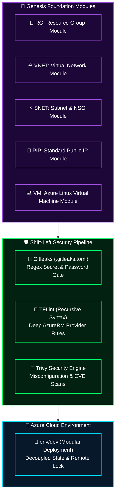

<div align="center">

# 🛡️ Genesis: Enterprise Azure Terraform & Security Framework
### Modular Infrastructure as Code with Custom Gitleaks Rules, TFLint & Multi-Stage Pipelines

[](https://azure.microsoft.com)
[](https://terraform.io)
[](#-custom-gitleaks-rules-in-gitleakstoml)
[](#-verification-commands)

**Architected by [Mihir Maurya](https://github.com/MihirMaurya-dev) · Enterprise Cloud Architect & DevSecOps**

</div>

---

## 🏗️ Architectural Topology

The **Genesis Infrastructure Framework** is an enterprise-grade Terraform codebase engineered for Microsoft Azure. Designed with strict separation of concerns, the platform isolates foundation modules (`RG`, `VNET`, `SNET`, `PIP`, `VM`) and enforces automated pre-commit scanning to block committed credentials, cleartext passwords in `.tfvars`, and permissive network rules.



---

## 🧰 Technology Stack & Tooling

<div align="center">

<a href="https://skillicons.dev">
  
</a>

</div>

<br/>

---

## 📂 Repository Topology

```text
genesis-iac-security-framework/
├── .gitleaks.toml           # 🔑 Custom Gitleaks rule definitions
├── azure-pipelines.yml       # 🔄 Azure DevOps Multi-Stage Pipeline
├── env/
│   └── dev/                  # 🧪 Root environment deployment
│       ├── main.tf           # Module caller & dependency chaining
│       ├── providers.tf      # AzureRM provider configuration
│       ├── terraform.tfvars  # Input variables
│       └── variables.tf
│
└── modules/                  # 🧩 REUSABLE TERRAFORM MODULES
    ├── PIP/                  # Public IP allocation module
    ├── RG/                   # Resource Group & Tagging governance
    ├── SNET/                 # Subnet generator with NSG binding
    ├── VM/                   # Virtual Machine compute module
    └── VNET/                 # Virtual Network address space generator
```

---

## 🔑 Custom Gitleaks Rules in `.gitleaks.toml`

This framework uses custom regex rules specifically designed to detect passwords in `*.tfvars` and `*.tf` files that standard default rules miss:

```toml
title = "Optimized Gitleaks Configuration for Terraform"

[[rules]]
id = "terraform-cleartext-password"
description = "Detects hardcoded admin passwords in Terraform variable definitions"
regex = '''(?i)(?:admin_password|password|secret|access_key)\s*=\s*["'][^"']{4,}["']'''
tags = ["terraform", "credentials", "security"]
```

---

## ⚡ Local Verification Commands

```bash
# 1. Run custom Gitleaks secret detection
gitleaks detect --source . --config .gitleaks.toml --verbose

# 2. Run recursive TFLint rule enforcement
tflint --recursive

# 3. Scan configuration misconfigurations via Trivy
trivy config --tf-vars .\env\dev\terraform.tfvars .
```

---

<div align="center">

**[Portfolio](https://mihirmaurya-dev.github.io/)** · **[LinkedIn](https://linkedin.com/in/mihirmauryaa1)** · **[DevOps Knowledge Vault](https://github.com/MihirMaurya-dev/DevOps-Notes)**

</div>
